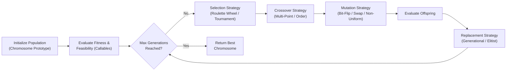

# Genetic Algorithm Toolbox & CVRP Solver

A modular, extensible **Genetic Algorithm (GA) Toolbox** built from scratch in Python using **Object-Oriented Design**, **Abstract Base Classes (`abc`)**, the **Strategy Pattern**, and **Dependency Injection**, applied to solve the **Capacitated Vehicle Routing Problem (CVRP)**.

---

## Abstract Architecture Overview

The toolbox decouples the core evolutionary loop from problem-specific representations and genetic operators:

1. **Abstract Base Classes (`ABC`)**: Define strict contracts for chromosomes and genetic operators (`Chromosome`, `SelectionStrategy`, `CrossoverStrategy`, `MutationStrategy`, `ReplacementStrategy`). Any concrete implementation must fulfill its abstract interface.
2. **Strategy Pattern & Dependency Injection**: `GAToolbox` acts as the high-level orchestrator. Instead of hardcoding specific operators, it depends on abstract strategy interfaces injected at initialization (with type-aware defaults when omitted).
3. **Prototype Pattern (`Chromosome`)**: The engine accepts a `chromosome_prototype` and uses its `clone()`, `initialize_random()`, `validate()`, `invalidate()`, and `is_better_than()` contracts to generate, validate, and rank individuals without coupling the engine to a specific gene encoding.
4. **First-Class Functions (`Callable`) & Feasibility-First Ranking**: Problem-specific evaluation logic (`fitness_fn` and `feasibility_fn`) is passed directly as Python callables. Infeasible solutions are handled using **Deb's feasibility-first rule** (`is_better_than`) combined with problem-level or optional engine-level penalty functions.

---

## Architecture Graph

### Component & Class Hierarchy Diagram

```mermaid
classDiagram
    direction TB

    class GAToolbox {
        +Chromosome chromosome_prototype
        +Callable fitness_fn
        +Callable feasibility_fn
        +SelectionStrategy selection_strategy
        +CrossoverStrategy crossover_strategy
        +MutationStrategy mutation_strategy
        +ReplacementStrategy replacement_strategy
        +int population_size
        +int max_generations
        +float crossover_rate
        +float mutation_rate
        +bool maximize
        +float infeasibility_penalty
        +int seed
        +list~float~ history
        +initialize_population() list~Chromosome~
        +evaluate_population(population) None
        +run() Chromosome
    }

    class Chromosome {
        <<abstract>>
        +int length
        +list genes
        +float fitness
        +bool is_feasible
        +invalidate() None
        +is_better_than(other, maximize) bool
        +initialize_random()* None
        +clone()* Chromosome
        +validate()* bool
    }

    class BinaryChromosome {
        +initialize_random() None
        +clone() BinaryChromosome
        +validate() bool
    }

    class IntegerChromosome {
        +int lower_bound
        +int upper_bound
        +bool is_permutation
        +initialize_random() None
        +clone() IntegerChromosome
        +validate() bool
    }

    class FloatingPointChromosome {
        +float lower_bound
        +float upper_bound
        +initialize_random() None
        +clone() FloatingPointChromosome
        +validate() bool
    }

    class SelectionStrategy {
        <<abstract>>
        +select(population, num_parents, maximize)* list~Chromosome~
    }

    class RouletteWheelSelection {
        +select(population, num_parents, maximize) list~Chromosome~
    }

    class TournamentSelection {
        +int k
        +select(population, num_parents, maximize) list~Chromosome~
    }

    class CrossoverStrategy {
        <<abstract>>
        +crossover(parent1, parent2)* tuple~Chromosome, Chromosome~
    }

    class MultiPointCrossover {
        +int num_points
        +crossover(parent1, parent2) tuple~Chromosome, Chromosome~
    }

    class OrderCrossover {
        +crossover(parent1, parent2) tuple~Chromosome, Chromosome~
    }

    class MutationStrategy {
        <<abstract>>
        +mutate(chromosome, mutation_rate, current_generation)* Chromosome
    }

    class BitFlipMutation {
        +mutate(chromosome, mutation_rate, current_generation) Chromosome
    }

    class SwapMutation {
        +mutate(chromosome, mutation_rate, current_generation) Chromosome
    }

    class NonUniformMutation {
        +float b
        +int max_generations
        +mutate(chromosome, mutation_rate, current_generation) Chromosome
    }

    class ReplacementStrategy {
        <<abstract>>
        +replace(current_pop, offspring_pop, maximize)* list~Chromosome~
    }

    class GenerationalReplacement {
        +replace(current_pop, offspring_pop, maximize) list~Chromosome~
    }

    class ElitistReplacement {
        +int elitism_count
        +replace(current_pop, offspring_pop, maximize) list~Chromosome~
    }

    class CVRPProblem {
        +list~list~int~~ distance_matrix
        +list~int~ demands
        +list~int~ vehicle_capacities
        +int num_vehicles
        +int depot
        +int num_customers
        +Chromosome best_solution
        +from_json(json_path)$ CVRPProblem
        +decode_routes(chromosome) tuple~list, list~
        +is_feasible(chromosome) bool
        +evaluate_fitness(chromosome) float
        +optimize(...) Chromosome
        +format_solution(chromosome) str
        +save_solution_to_txt(output_path, chromosome) str
    }

    CVRPProblem --> GAToolbox : configures & runs
    CVRPProblem --> IntegerChromosome : uses permutation prototype
    GAToolbox --> Chromosome : uses prototype
    GAToolbox --> SelectionStrategy : delegates selection
    GAToolbox --> CrossoverStrategy : delegates crossover
    GAToolbox --> MutationStrategy : delegates mutation
    GAToolbox --> ReplacementStrategy : delegates replacement

    Chromosome <|-- BinaryChromosome
    Chromosome <|-- IntegerChromosome
    Chromosome <|-- FloatingPointChromosome

    SelectionStrategy <|-- RouletteWheelSelection
    SelectionStrategy <|-- TournamentSelection

    CrossoverStrategy <|-- MultiPointCrossover
    CrossoverStrategy <|-- OrderCrossover

    MutationStrategy <|-- BitFlipMutation
    MutationStrategy <|-- SwapMutation
    MutationStrategy <|-- NonUniformMutation

    ReplacementStrategy <|-- GenerationalReplacement
    ReplacementStrategy <|-- ElitistReplacement
```



### Evolutionary Pipeline Flow



---

## Module Breakdown

| Module | Abstract Base Class | Concrete Implementations | Responsibility |
| :--- | :--- | :--- | :--- |
| `ga_toolbox/chromosome.py` | `Chromosome` | `BinaryChromosome`, `IntegerChromosome`, `FloatingPointChromosome` | Encodes candidate solutions, initializes random genes, validates bounds/permutations, clones individuals, and compares chromosomes using Deb's feasibility-first rule (`is_better_than`). |
| `ga_toolbox/selection.py` | `SelectionStrategy` | `RouletteWheelSelection`, `TournamentSelection` | Selects parent chromosomes from the current population based on feasibility and fitness. |
| `ga_toolbox/crossover.py` | `CrossoverStrategy` | `MultiPointCrossover`, `OrderCrossover` | Recombines pairs of parent chromosomes to produce offspring. |
| `ga_toolbox/mutation.py` | `MutationStrategy` | `BitFlipMutation`, `SwapMutation`, `NonUniformMutation` | Introduces stochastic gene variations to maintain diversity. |
| `ga_toolbox/replacement.py` | `ReplacementStrategy` | `GenerationalReplacement`, `ElitistReplacement` | Determines which individuals from the parent and offspring populations survive into the next generation. |
| `ga_toolbox/engine.py` | — (`GAToolbox`) | `GAToolbox` | Configures hyperparameters, injects callables/strategies, handles infeasible solutions, and runs the GA lifecycle. |
| `cvrp/cvrp_problem.py` | — (`CVRPProblem`) | `CVRPProblem` | Loads CVRP instance data from JSON, decodes permutation chromosomes into vehicle routes, checks capacity feasibility, computes route distance + penalties, and formats output in Google OR-Tools style. |

---

## Project Structure

```text
Genetic-Algorithm-Toolbox/
├── README.md
├── main.py
├── ga_toolbox/
│   ├── __init__.py
│   ├── chromosome.py
│   ├── selection.py
│   ├── crossover.py
│   ├── mutation.py
│   ├── replacement.py
│   └── engine.py
├── cvrp/
│   ├── __init__.py
│   ├── cvrp_input.json
│   ├── cvrp_output.txt
│   └── cvrp_problem.py
└── tests/
    ├── __init__.py
    ├── test_chromosome.py
    ├── test_operators.py
    ├── test_engine.py
    └── test_cvrp.py
```

---

## Running the Project & Tests

> **Requirements:** Python 3.10+ (uses standard library only; no external dependencies required).

### 1. Run the CVRP Solver
```bash
python3 main.py
```

Sample output (`cvrp/cvrp_output.txt`, matching the Google OR-Tools reference total distance of `6208m`):
```text
Route for vehicle 0:
 0 Load(0) ->  13 Load(4) ->  15 Load(12) ->  11 Load(13) ->  12 Load(15) ->  0 Load(15)
Distance of the route: 1552m
Load of the route: 15

Route for vehicle 1:
 0 Load(0) ->  5 Load(2) ->  2 Load(3) ->  6 Load(7) ->  8 Load(15) ->  0 Load(15)
Distance of the route: 1552m
Load of the route: 15

Route for vehicle 2:
 0 Load(0) ->  10 Load(2) ->  16 Load(10) ->  14 Load(14) ->  9 Load(15) ->  0 Load(15)
Distance of the route: 1552m
Load of the route: 15

Route for vehicle 3:
 0 Load(0) ->  7 Load(8) ->  1 Load(9) ->  3 Load(11) ->  4 Load(15) ->  0 Load(15)
Distance of the route: 1552m
Load of the route: 15

Total distance of all routes: 6208m
Total load of all routes: 60
```

### 2. Reusing `GAToolbox` on a Custom Optimization Problem
```python
from ga_toolbox import BinaryChromosome, GAToolbox

ga = GAToolbox(
    chromosome_prototype=BinaryChromosome(length=10),
    fitness_fn=lambda chrom: float(sum(chrom.genes)),
    feasibility_fn=lambda chrom: sum(chrom.genes) <= 7,
    population_size=50,
    max_generations=100,
    maximize=True,
    seed=42,
)
best = ga.run()
print(best.genes, best.fitness, best.is_feasible)
```

### 3. Run the Unit & Integration Test Suite
Run from the repository root:
```bash
python3 -m unittest -v
```

| Test file | What it covers |
| :--- | :--- |
| `tests/test_chromosome.py` | Construction errors, random initialization ranges, deep cloning, `validate()`, `invalidate()`, and feasibility-first `is_better_than()`. |
| `tests/test_operators.py` | Behavior of every operator: tournament/roulette selection pressure and feasibility preference, N-point switch counts, a hand-computed OX example, mutation-rate edge cases, non-uniform step decay and bounds, and elitist/generational survivor sets. |
| `tests/test_engine.py` | Hyperparameter validation, type-aware defaults, penalty handling, history length/monotonicity, seed reproducibility, odd population sizes, `current_generation` propagation, clear errors for broken strategies, and end-to-end runs on binary, float, and permutation problems. |
| `tests/test_cvrp.py` | JSON loading, decoding the OR-Tools reference routes (6208m), capacity checks, infeasibility penalties, output format, and a seeded end-to-end solve. |
