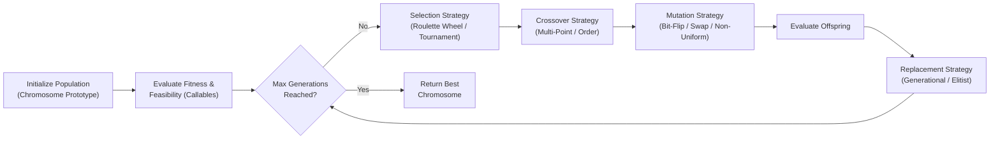

# Genetic Algorithm Toolbox

A modular, extensible **Genetic Algorithm (GA) Toolbox** built in Python using **Object-Oriented Design**, **Abstract Base Classes (`abc`)**, the **Strategy Pattern**, and **Dependency Injection**.

---

## Abstract Architecture Overview

The toolbox decouples the core evolutionary loop from problem-specific representations and genetic operators:

1. **Abstract Base Classes (`ABC`)**: Define strict contracts for chromosomes and genetic operators (`Chromosome`, `SelectionStrategy`, `CrossoverStrategy`, `MutationStrategy`, `ReplacementStrategy`). Any concrete implementation must fulfill its abstract interface.
2. **Strategy Pattern & Dependency Injection**: `GAToolbox` acts as the high-level orchestrator. Instead of hardcoding specific operators, it depends on abstract strategy interfaces injected at initialization (with sensible defaults when omitted).
3. **Prototype Pattern (`Chromosome`)**: The engine accepts a `chromosome_prototype` and uses its `clone()` and `initialize_random()` contracts to generate and copy individuals without coupling the engine to a specific gene encoding.
4. **First-Class Functions (`Callable`)**: Problem-specific evaluation logic (`fitness_fn` and `feasibility_fn`) is passed directly as Python callables, allowing users to optimize custom problems without subclassing the engine.

---

## Architecture Graph

### Component & Class Hierarchy Diagram

```mermaid
classDiagram
    direction TB

    class GAToolbox {
        +Chromosome chromosome_prototype
        +Callable fitness_fn
        +Callable feasibility_fn
        +SelectionStrategy selection_strategy
        +CrossoverStrategy crossover_strategy
        +MutationStrategy mutation_strategy
        +ReplacementStrategy replacement_strategy
        +int population_size
        +int max_generations
        +float crossover_rate
        +float mutation_rate
        +bool maximize
        +initialize_population() list~Chromosome~
        +evaluate_population(population) None
        +run() Chromosome
    }

    class Chromosome {
        <<abstract>>
        +int length
        +list genes
        +float fitness
        +bool is_feasible
        +initialize_random()* None
        +clone()* Chromosome
    }

    class BinaryChromosome {
        +initialize_random() None
        +clone() BinaryChromosome
    }

    class IntegerChromosome {
        +int lower_bound
        +int upper_bound
        +bool is_permutation
        +initialize_random() None
        +clone() IntegerChromosome
    }

    class FloatingPointChromosome {
        +float lower_bound
        +float upper_bound
        +initialize_random() None
        +clone() FloatingPointChromosome
    }

    class SelectionStrategy {
        <<abstract>>
        +select(population, num_parents, maximize)* list~Chromosome~
    }

    class RouletteWheelSelection {
        +select(population, num_parents, maximize) list~Chromosome~
    }

    class TournamentSelection {
        +int k
        +select(population, num_parents, maximize) list~Chromosome~
    }

    class CrossoverStrategy {
        <<abstract>>
        +crossover(parent1, parent2)* tuple~Chromosome, Chromosome~
    }

    class MultiPointCrossover {
        +int num_points
        +crossover(parent1, parent2) tuple~Chromosome, Chromosome~
    }

    class OrderCrossover {
        +crossover(parent1, parent2) tuple~Chromosome, Chromosome~
    }

    class MutationStrategy {
        <<abstract>>
        +mutate(chromosome, mutation_rate)* Chromosome
    }

    class BitFlipMutation {
        +mutate(chromosome, mutation_rate) Chromosome
    }

    class SwapMutation {
        +mutate(chromosome, mutation_rate) Chromosome
    }

    class NonUniformMutation {
        +mutate(chromosome, mutation_rate) Chromosome
    }

    class ReplacementStrategy {
        <<abstract>>
        +replace(current_pop, offspring_pop, maximize)* list~Chromosome~
    }

    class GenerationalReplacement {
        +replace(current_pop, offspring_pop, maximize) list~Chromosome~
    }

    class ElitistReplacement {
        +int elitism_count
        +replace(current_pop, offspring_pop, maximize) list~Chromosome~
    }

    GAToolbox --> Chromosome : uses prototype
    GAToolbox --> SelectionStrategy : delegates selection
    GAToolbox --> CrossoverStrategy : delegates crossover
    GAToolbox --> MutationStrategy : delegates mutation
    GAToolbox --> ReplacementStrategy : delegates replacement

    Chromosome <|-- BinaryChromosome
    Chromosome <|-- IntegerChromosome
    Chromosome <|-- FloatingPointChromosome

    SelectionStrategy <|-- RouletteWheelSelection
    SelectionStrategy <|-- TournamentSelection

    CrossoverStrategy <|-- MultiPointCrossover
    CrossoverStrategy <|-- OrderCrossover

    MutationStrategy <|-- BitFlipMutation
    MutationStrategy <|-- SwapMutation
    MutationStrategy <|-- NonUniformMutation

    ReplacementStrategy <|-- GenerationalReplacement
    ReplacementStrategy <|-- ElitistReplacement
```



### Evolutionary Pipeline Flow



---

## Module Breakdown

| Module | Abstract Base Class | Concrete Implementations | Responsibility |
| :--- | :--- | :--- | :--- |
| `chromosome.py` | `Chromosome` | `BinaryChromosome`, `IntegerChromosome`, `FloatingPointChromosome` | Encodes candidate solutions, initializes random genes, and clones individuals. |
| `selection.py` | `SelectionStrategy` | `RouletteWheelSelection`, `TournamentSelection` | Selects parent chromosomes from the current population based on fitness. |
| `crossover.py` | `CrossoverStrategy` | `MultiPointCrossover`, `OrderCrossover` | Recombines pairs of parent chromosomes to produce offspring. |
| `mutation.py` | `MutationStrategy` | `BitFlipMutation`, `SwapMutation`, `NonUniformMutation` | Introduces stochastic gene variations to maintain diversity. |
| `replacement.py` | `ReplacementStrategy` | `GenerationalReplacement`, `ElitistReplacement` | Determines which individuals survive into the next generation. |
| `engine.py` | — (`GAToolbox`) | `GAToolbox` | Configures hyperparameters, injects callables/strategies, and runs the GA lifecycle. |

---

## Project Structure

```text
Genetic-Algorithm-Toolbox/
├── README.md
├── main.py
└── ga_toolbox/
    ├── __init__.py
    ├── chromosome.py
    ├── selection.py
    ├── crossover.py
    ├── mutation.py
    ├── replacement.py
    └── engine.py
```
